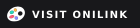

  <h1>Daniel Oniyide</h1>

  

    <code>Aspiring Cybersecurity Professional | Founder of OniLink</code>
  

  
<i>Learning. Securing. Innovating.</i>

  
📍 <strong>London, UK</strong>

  

<h2>About Me</h2>

<blockquote>

  

    Year 12 student studying a T Level in Specialist Digital Software 
    Development, with aspirations of becoming a 
    <strong>cybersecurity professional</strong> and a strong interest 
    in software engineering, AI and ML security.
  

  

    Founder of <strong><a href="https://onilink.uk">OniLink</a></strong>, 
    a personalised technology business combining hand-drawn artwork 
    with NFC technology. I oversee its digital infrastructure, 
    technical development and business operations.
  

  

    When I’m not coding or researching, you can find me in scenic 
    areas, photographing cinematic landscapes, or following Formula 1, 
    as a dedicated enthusiast who appreciates split-second strategic 
    decisions, precision and exhilarating performance.
  

  

    Currently exploring degree apprenticeships and university 
    pathways, with the goal of building a career in cybersecurity. 
    I’m always open to connecting with professionals in the 
    cybersecurity and software engineering spaces.
  

</blockquote>

<ul>
  <li>🐍 Building projects with Python</li>
  <li>🔐 Working towards a career in cybersecurity</li>
  <li>🌐 Exploring AI and security practices</li>
  <li>💻 Learning through projects and hands-on experience</li>
  <li>🚀 Developing and expanding OniLink</li>
</ul>

<h2>Tech Stack</h2>

  <h3>Programming Languages</h3>

  

  <h3>Development Tools</h3>

  

  

  

  

  <h3>Python Libraries</h3>

  

  

  <h3>Platforms and Services Used in OniLink</h3>

  

  

  

  

  

  

<h2>Technical Interests</h2>

<ul>
  <li>Cybersecurity and vulnerability research</li>
  <li>Artificial intelligence and machine learning security</li>
  <li>Cloud computing and infrastructure security</li>
  <li>Software engineering and development</li>
  <li>Data analytics and automation</li>
  <li>Digital privacy and risk management</li>
  <li>Incident response and threat detection</li>
</ul>

<h2>Featured Project</h2>

  <h3>OniLink</h3>

  
<code>Your identity. Your design. One tap.</code>

  <strong>OniLink</strong> is a personalised technology business 
  combining individually hand-drawn artwork with Near Field 
  Communication (NFC) technology, allowing customers to share 
  digital information with a single tap.

  As its founder, I oversee the development of its digital ecosystem, 
  gaining practical exposure to software engineering, cloud 
  infrastructure, automation, cybersecurity and business management.

<h3>Technical Infrastructure</h3>

<ul>
  <li>E-commerce and order management infrastructure</li>
  <li>Cloudflare Workers, Pages and D1</li>
  <li>Database integration and management</li>
  <li>Automated email communications using Resend</li>
  <li>Stripe payment integration</li>
  <li>Administrative dashboard</li>
  <li>Website security, accessibility and optimisation</li>
</ul>

<h3>Development Roadmap</h3>

<ul>
  <li>Enhanced customer experience and order tracking</li>
  <li>Customer design approval and management portals</li>
  <li>Inventory management and financial analytics</li>
  <li>Expansion into additional personalised NFC products</li>
  <li>Dynamic NFC links and digital customer profiles</li>
  <li>Scalable e-commerce infrastructure</li>
</ul>

  

<h2>Other Projects</h2>

<h3>Hyperattack</h3>

  A two-player competitive arena game developed using Godot 
  as part of a five-person team during Hack Club Haven London 2026.
  The project achieved first place in the competition.

<ul>
  <li>Collaborative game development</li>
  <li>GitHub version control</li>
  <li>Problem-solving and iterative testing</li>
  <li>Working within a time-constrained development environment</li>
</ul>

<h3>Python Development Projects</h3>

<ul>
  <li>Vehicle registration validation system</li>
  <li>Grocery store inventory management system</li>
  <li>Library management system</li>
  <li>Stock market data analysis and visualisation</li>
</ul>

<h2>Achievements and Professional Development</h2>

<ul>
  <li>🏆 First Place | Hack Club Haven London 2026</li>
  <li>🔐 Cisco Introduction to Cybersecurity</li>
  <li>💻 Barclays Developer Virtual Work Experience</li>
  <li>☁️ Amazon Cloud Computing Virtual Work Experience</li>
  <li>🤖 AI Innovator Programme (ongoing)</li>
  <li>🏢 Aon Work Experience</li>
  <li>🎓 Principal Award for Integrity 2025</li>
</ul>

<h2>Currently Working On</h2>

<ul>
  <li>Expanding OniLink into a scalable technology platform</li>
  <li>Developing my Python programming skills</li>
  <li>Expanding my cybersecurity knowledge</li>
  <li>Exploring artificial intelligence and machine learning security</li>
  <li>Building practical, real-world software projects</li>
  <li>Exploring degree apprenticeship and university opportunities</li>
</ul>

<h2>Connect</h2>

  

  

  

  

  <h3><code>Stay blessed.</code></h3>

  

    <i>Build technology. Understand technology. Secure technology.</i>
  

   

  

    <code>Thanks for stopping by. Feel free to follow, connect or email me for any enquiries.</code>
  

